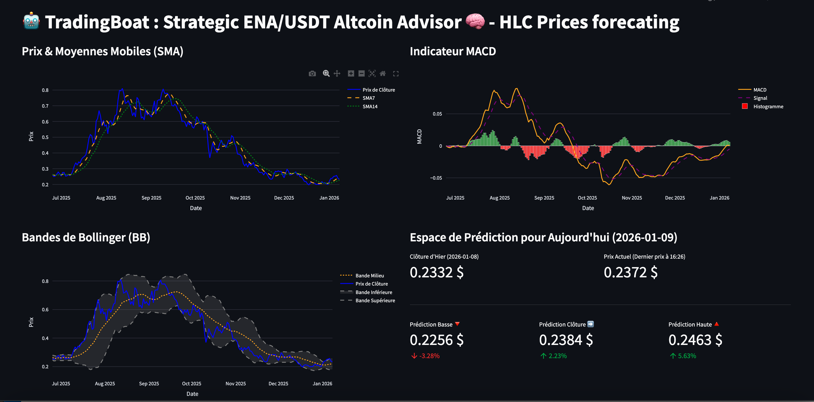
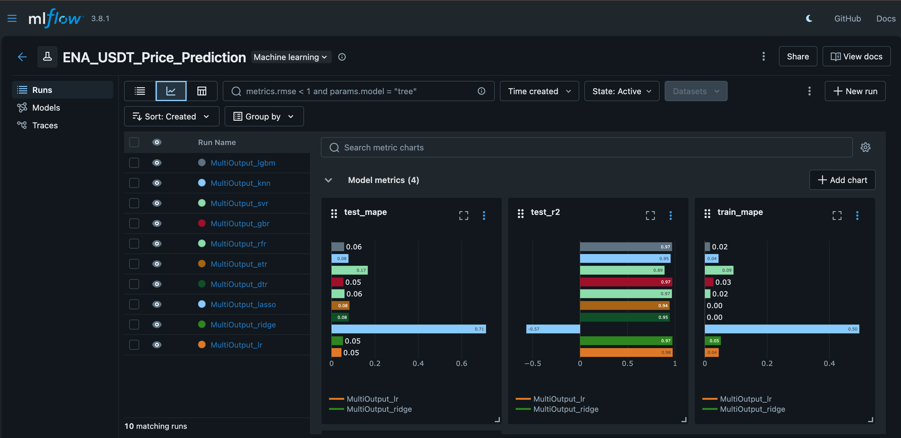

# 🤖 TradingBoat: Strategic ENA/USDT Altcoin Advisor

**TradingBoat** is an algorithmic trading ecosystem designed to predict price movements for the **ENA/USDT** pair on Binance. This project bridges the gap between quantitative research and live execution by combining real-time data extraction, multi-output machine learning models, and an interactive monitoring dashboard.

---

## 🌟 Key Features

- **Live Data Pipeline**: Real-time OHLCV data ingestion from Binance via the **CCXT** library.
- **Multi-Output Forecasting**: Simultaneously predicts the **High, Low, and Close** prices for the upcoming candle (meaning candle of the next day) to define volatility ranges.
- **Machine Learning Pipeline**:
  - Comprehensive training and comparison of multiple architectures: **Linear Regression, Random Forest, and Ridge**.
  - Experiment tracking and performance logging (MAPE, R²) using **MLflow**.

- **Interactive Dashboard**: A dedicated **Streamlit** interface featuring:
  - Live price monitoring.
  - Interactive financial charts powered by **Plotly**.
  - Automated trading signal generation (Long/Short) with calculated **Take Profit (TP)** and **Stop Loss (SL)** levels.

---

## 🛠️ Tech Stack

- **Language**: Python 3.11  
- **Data Science**: Pandas, NumPy, Scikit-Learn, Joblib  
- **MLOps**: MLflow (Experiment Tracking & Model Registry)  
- **Interface**: Streamlit, Plotly  
- **Finance / API**: CCXT (Binance API)  

---

## 📁 Project Structure

~~~text
├── assets/                  # Documentation assets (Screenshots, Diagrams)
├── data/                    # Historical market data (ena_ohlcv.csv)
├── mlruns/                  # MLflow experiment tracking logs
├── models/                  # Serialized models (.pkl) and scalers
├── tradenv/                 # Python virtual environment (local)
├── modeling_ena.ipynb       # R&D Notebook (Data Prep, Training, MLflow Tracking)
├── crypto_app.py            # Streamlit application (Live Inference & UI)
├── feature_eng.py           # Custom feature engineering logic
├── mlflow.db                # MLflow local SQLite database
├── requirements.txt         # Project dependencies
└── README.md                # Project documentation
~~~

---

## 🚀 Getting Started

### 1. Installation & Environment

~~~bash
# Clone the repository
git clone https://github.com/Oumarkei/tradingboat.git
cd tradingboat

# Activate the virtual environment 
source tradenv/bin/activate  # macOS / Linux
pip install -r requirements.txt
~~~

---

### 2. Model Training

Run the `modeling_ena.ipynb` notebook to:

- Fetch historical ENA/USDT data
- Perform feature engineering
- Train and evaluate multiple models
- Track experiments with MLflow

The best-performing models are automatically saved in the `models/` directory.

---

### 3. Launching the Dashboard

Start the real-time trading advisor with:

~~~bash
streamlit run crypto_app.py
~~~

---

## 📊 Strategy & Logic

Instead of predicting a single price point, **TradingBoat forecasts a price range** to improve risk management:

- **Long Signal**  
  Triggered when the current price approaches the predicted **Low**, with a target near the predicted **High**.

- **Risk Management**  
  Stop Loss (SL) and Take Profit (TP) levels are dynamically calculated based on the predicted volatility, ensuring a favorable risk-to-reward ratio.

---

## ⚠️ Disclaimer

This project is for **educational and research purposes only**.  
Cryptocurrency trading involves significant financial risk.  

I am not responsible for any financial losses incurred through the use of this software.  
Always trade responsibly and do your own research.

## 👤 Created By

**Oumar KEITA**  
Data Scientist | Industrial Management Engineer  
LinkedIn: https://www.linkedin.com/in/oumar-keita-a04374245/  

## Développement

Ce dépôt sera enrichi progressivement avec de nouvelles fonctionnalités et améliorations.
